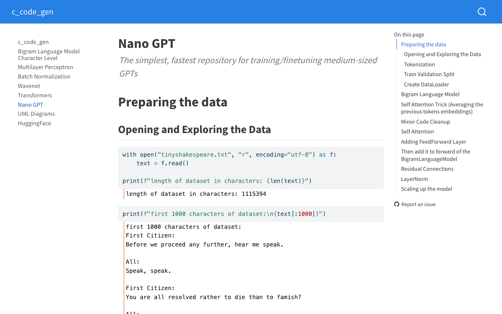

# c_code_gen

Learning notebooks that build a GPT step by step (bigram, MLP, BatchNorm, WaveNet, Transformer, nano GPT) and then fine-tune a GPT-2 style model on embedded C code with Hugging Face. Built with [nbdev](https://nbdev.fast.ai).



*The rendered `05_nano_gpt.ipynb` page from the committed `docs/nano_gpt.html`, captured with Playwright.*

## Contents

| Notebook | Topic |
| --- | --- |
| `00_bigram.ipynb` | Character-level bigram language model (data: `names.txt`) |
| `01_mlp.ipynb` | Multilayer perceptron |
| `02_bn.ipynb` | Batch normalization |
| `03_wavenet.ipynb` | WaveNet-style model |
| `04_transformers.ipynb` | Transformer implementation |
| `05_nano_gpt.ipynb` | nano GPT on `tinyshakespeare.txt` |
| `06_uml_diagrams.ipynb` | UML diagrams |
| `07_huggingface.ipynb` | Fine-tuning on C code (`train_c_code.txt`, `test_c_code.txt`) |

`bigram.py` and `c_code_gen/` are the nbdev-exported modules. Rendered docs are in `docs/` (deployed to GitHub Pages).

## Run

Requires Python 3.7+ (per `settings.ini`) and Jupyter. The repo has no pinned requirements file; install what the notebooks import (e.g. `torch`, `transformers`).

```sh
pip install nbdev jupyter torch transformers
jupyter lab
```

Export modules and rebuild docs with `nbdev_export` and `nbdev_docs`. `nbdev_test` is configured with `tst_flags = notest`.

## License

Apache 2.0, see `LICENSE`.
